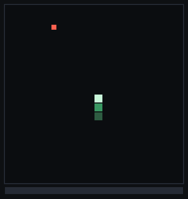
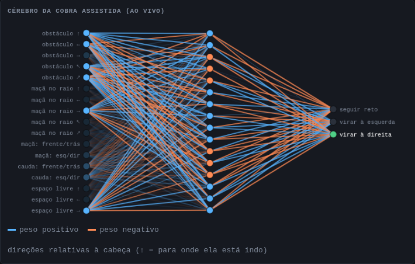
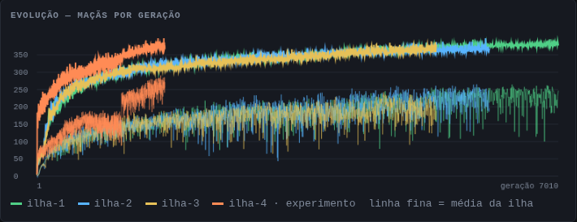

# Snake com neuroevolução

Uma IA que aprende a jogar Snake sozinha, sem nenhuma biblioteca de IA: só JavaScript, uma rede neural minúscula e seleção natural.

**[Ver rodando no navegador](https://im-fernando.github.io/snake-neuroevolucao/)**: a página abre com a cobra que zerou o jogo (397 maçãs no tabuleiro 20×20). Dá pra trocar no seletor e ver uma população evoluindo do zero, ao vivo. Quer pular direto pro fim? [`?pular=24700`](https://im-fernando.github.io/snake-neuroevolucao/?pular=24700)



## Como funciona

- Cada cobra tem uma rede neural `17 → 16 (tanh) → 3`, com 339 pesos no total
- 500 cobras por geração. Todas jogam a mesma partida, as que comem mais maçãs viram pais da próxima
- Filhos misturam os pesos dos pais (cruzamento uniforme) e recebem ruído gaussiano em ~8% dos pesos (mutação)
- As 4% melhores passam direto pra próxima geração (elitismo), seleção por torneio de 5

**O que ela enxerga (17 entradas, tudo relativo à direção da cabeça):**

- 5 raios (frente, esquerda, direita e as duas diagonais da frente): distância até o obstáculo e se tem maçã na linha
- Posição da maçã e da cauda em relação à cabeça
- Espaço livre alcançável (flood fill) se ela for pra frente, pra esquerda ou pra direita

**Saídas:** seguir reto, virar à esquerda, virar à direita.



## Arquivos

| arquivo | o que é |
|---|---|
| `sim.js` | O núcleo: o jogo, os sensores, a rede neural e o algoritmo genético. Roda no navegador e no Node |
| `index.html` | A página: evolução ao vivo, replay e o "cérebro" acendendo a cada jogada |
| `train.js` | Treino headless em Node, com `worker_threads` e modelo de ilhas (várias máquinas trocando as melhores cobras) |
| `hub.sh` | A central de migração entre as ilhas, chamada por uma chave SSH restrita |
| `campeao.json` | Os pesos da cobra que zerou, em Float32 base64 |

## Rodando

**No navegador:** abre a página publicada, ou serve a pasta localmente (o `campeao.json` só carrega via HTTP):

```bash
npx serve .
# ou
python3 -m http.server
```

**Treino em Node (uma máquina):**

```bash
ISLAND=ilha-a WORKERS=4 node train.js
```

**Várias máquinas (modelo de ilhas):** uma máquina é a central e as outras falam com ela por SSH:

```bash
# na central
ISLAND=ilha-a WORKERS=3 HUB=dir:/opt/snake-ia/hub SERVE=8642 node train.js

# nas outras
ISLAND=ilha-b WORKERS=3 HUB=ssh:usuario@central node train.js
```

A chave de cada ilha entra no `authorized_keys` da central restrita ao `hub.sh`, então ela só consegue trocar cobras e nada mais:

```
restrict,command="/opt/snake-ia/hub.sh" ssh-ed25519 AAAA... ilha-b
```

O progresso é salvo em `checkpoint.json` a cada minuto e retomado se o processo reiniciar.

**Experimento de fim de jogo** (opcional, por variável de ambiente):

| variável | efeito |
|---|---|
| `GAMES=3` | cada cobra joga 3 partidas, aptidão = média |
| `CURRIC=1` | mais 1 partida começando com a cobra já grande, a partir de posições dos campeões |
| `FIT=endgame` | passos quase não valem ponto, bônus grande por zerar |
| `HUNGER_K=5` | mais fôlego antes de morrer de fome quando o corpo é grande |

## Resultados



- Travou em 116 maçãs só com os raios. Com as 3 entradas de espaço livre, passou de 200 em 10 minutos
- Zerou pela primeira vez na geração 5.718, e depois mais duas ilhas também zeraram, rodando em 4 VPS
- A ilha do experimento de fim de jogo (laranja no gráfico) fica acima das outras na mesma geração, tanto no melhor quanto na média
- Mas nenhuma das cobras que zeraram, testadas em 100 partidas novas, zerou de novo. As melhores ficam numa mediana de 300 a 348 maçãs. O recorde tem muito de sorte

## Licença

MIT
